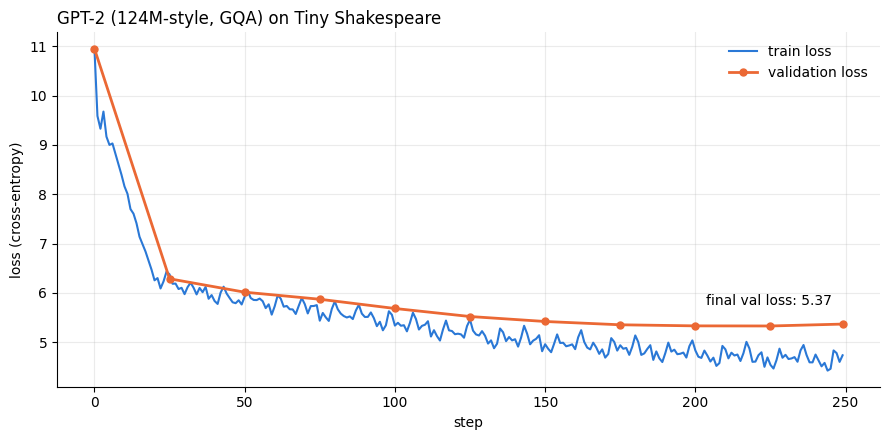

# GPT-2 with Grouped-Query Attention on Tiny Shakespeare

[](https://colab.research.google.com/github/ranaakbar107/GPT2_GQA_Shakespeare/blob/main/GPT2_GQA_Shakespeare.ipynb)

A from-scratch GPT-2 (124M-style) implementation in PyTorch, modified to use **Grouped-Query Attention (GQA)** instead of standard multi-head attention, and trained on the Tiny Shakespeare dataset on a single free Colab T4 GPU.

Based on Andrej Karpathy's [Let's reproduce GPT-2 (124M)](https://www.youtube.com/watch?v=l8pRSuU81PU) video and the [build-nanogpt](https://github.com/karpathy/build-nanogpt) repository.

## What is Grouped-Query Attention?

In standard multi-head attention, every query head has its own key and value head. In GQA, several query heads **share** one key/value head.

| | Query heads | Key/Value heads | Query heads per KV head |
|---|---|---|---|
| Multi-head attention (original GPT-2) | 12 | 12 | 1 |
| **Grouped-query attention (this repo)** | 12 | **4** | 3 |

This makes the K/V projections smaller (fewer parameters) and cuts the KV-cache used during generation by 3×, with little loss in quality. GQA is used in modern models such as Llama 2/3 and Mistral.

Paper: [GQA: Training Generalized Multi-Query Transformer Models from Multi-Head Checkpoints](https://arxiv.org/abs/2305.13245) (Ainslie et al., 2023)

## Model and training setup

| Setting | Value |
|---|---|
| Layers / embedding size | 12 / 768 |
| Query heads / KV heads | 12 / 4 |
| Parameters | 115.0M (vs ~124.5M with standard attention) |
| Context length | 512 tokens |
| Batch size | 16,384 tokens per step (8 × 512, 4 gradient-accumulation steps) |
| Training steps | 250 |
| Learning rate | 6e-4 peak, 25-step linear warmup, cosine decay to 6e-5 |
| Optimizer | AdamW (fused), weight decay 0.1, gradient clipping 1.0 |
| Precision | float16 + GradScaler (T4 does not support bfloat16) |
| Dataset | Tiny Shakespeare, GPT-2 tokenizer: 304K train / 34K validation tokens |
| Hardware | Google Colab, NVIDIA T4 (~16K tokens/sec, ~4.5 minutes total) |

## Results



| | Value |
|---|---|
| Initial validation loss | 10.95 |
| Best validation loss | **5.33** (step 225) |
| Final validation loss | 5.37 (step 249) |
| Final train loss | ~4.7 |

Validation loss fell steadily until step 225 and then rose slightly. With train loss well below validation loss after ~13.5 passes over the data, the model was starting to overfit, so stopping around step 225 would have been optimal.

### Sample output (prompt: `ROMEO:`)

```
ROMEO:
I say, I say
Thrah, the lady's one time of the head, sir: my lord!

And never no more to no than to the sun
A: to our
DUKEis thy heart, I see, sir,
```

The model learned Shakespeare's format (character names followed by a colon, short dialogue lines, words like "thou", "thy", "my lord"), but grammar is still weak and some character names are invented. That is expected for a 115M-parameter model trained on only ~300K tokens.

## How to run

**Option 1: Google Colab (recommended)**

1. Click the **Open in Colab** badge above.
2. Go to **Runtime → Change runtime type** and select **T4 GPU**.
3. Run all cells (**Runtime → Run all**).

**Option 2: Locally (needs an NVIDIA GPU)**

```bash
git clone https://github.com/ranaakbar107/GPT2_GQA_Shakespeare.git
cd GPT2_GQA_Shakespeare
pip install -r requirements.txt
jupyter notebook GPT2_GQA_Shakespeare.ipynb
```

The notebook downloads the Tiny Shakespeare dataset by itself.

## Notebook structure

1. **Setup**: check the GPU, install `tiktoken`, download and tokenize the dataset
2. **Model**: GPT-2 with GQA; sanity check by loading the original OpenAI GPT-2 weights and generating text
3. **Training**: Flash Attention, mixed precision, gradient accumulation, learning-rate schedule, train/validation split
4. **Results**: loss curve, generated Shakespeare samples, summary

## Acknowledgements

- [Andrej Karpathy](https://github.com/karpathy) for the original GPT-2 reproduction code ([build-nanogpt](https://github.com/karpathy/build-nanogpt), MIT license)
- Tiny Shakespeare dataset from [karpathy/char-rnn](https://github.com/karpathy/char-rnn)

## License

[MIT](LICENSE)
